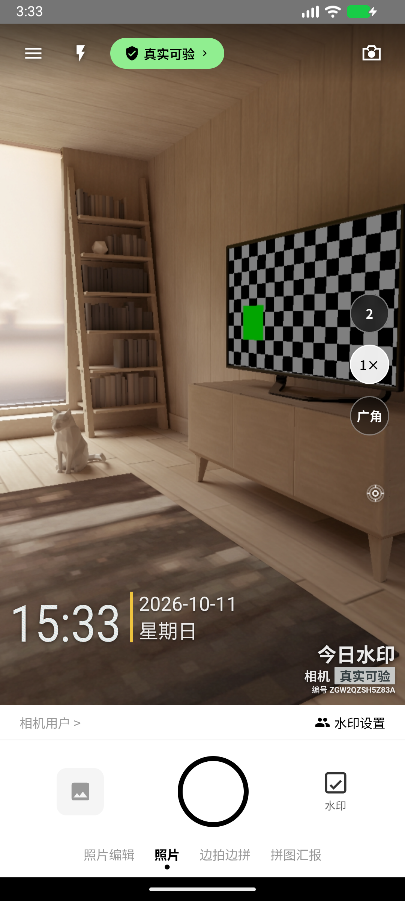
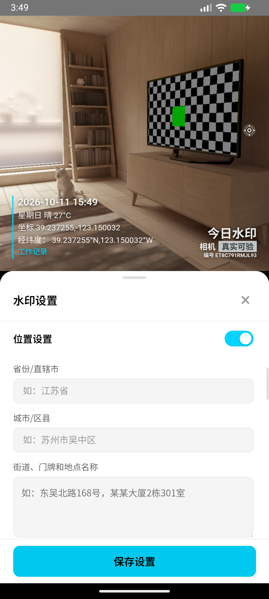
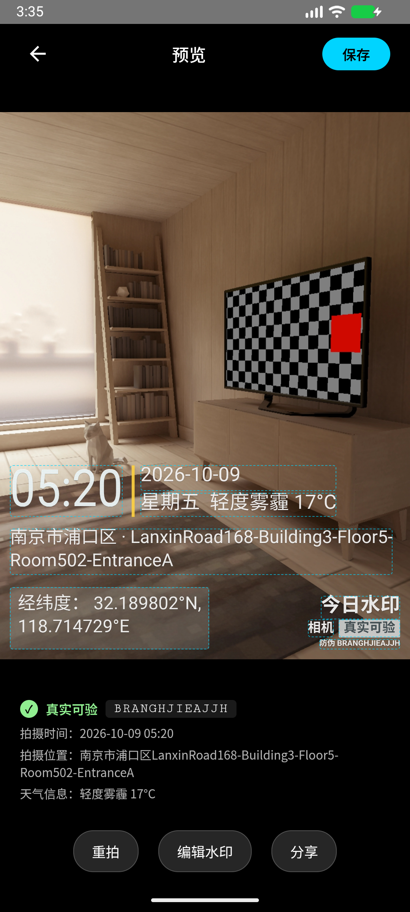
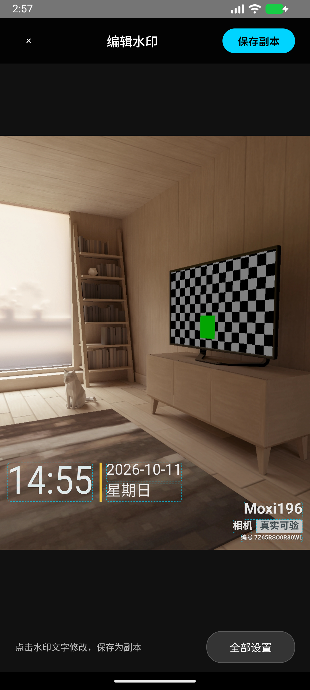
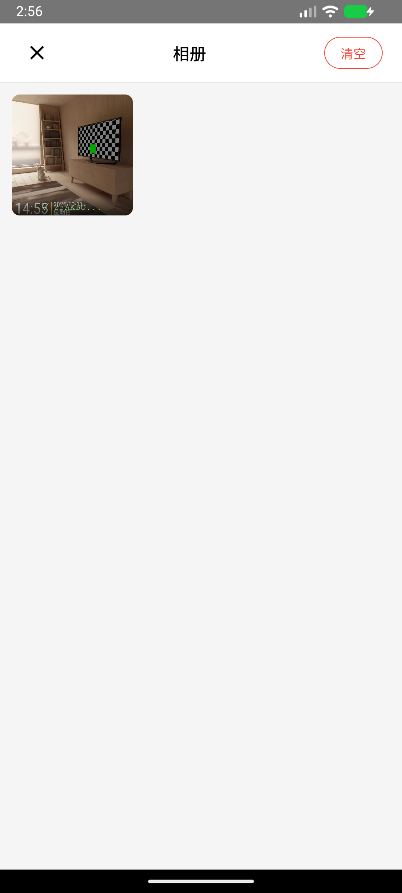
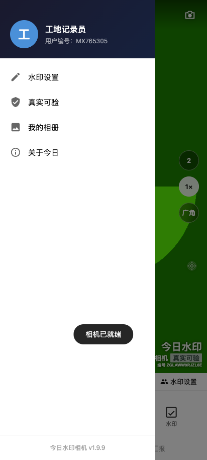
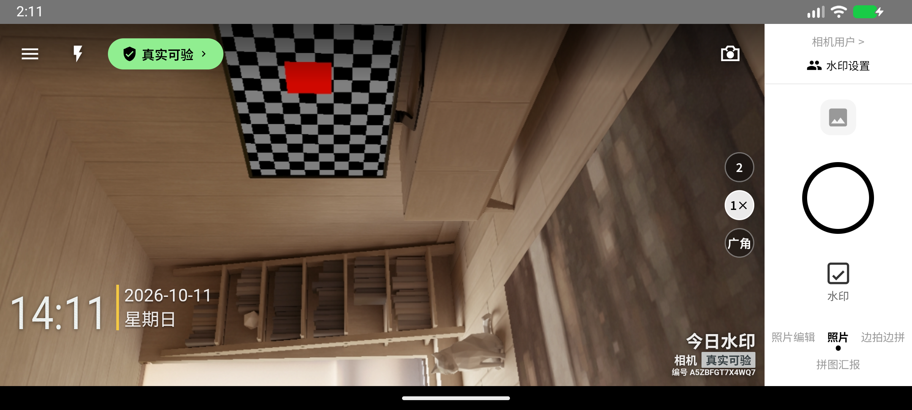
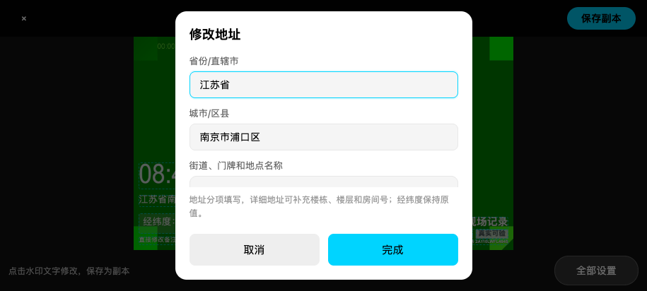

# 今日水印相机

Android 10 及以上可用的本地水印相机。安装 APK 后即可拍照，无需账号、会员、服务器或后台管理系统。页面、脚本和图片全部打包在 APK 内，不依赖远程网站。

当前版本：**v1.9.9**。基于 [ssmhdssmhd/mxsyxj](https://github.com/ssmhdssmhd/mxsyxj) 修改，保留 MIT 许可证。

## 页面截图

以下为 Android 模拟器和浏览器中的功能演示，地址、时间和用户资料使用测试数据。点击图片可查看原图。

<table>
  <tr>
    <th>拍照主页</th><th>水印设置 · 固定保存按钮</th><th>照片预览</th>
  </tr>
  <tr>
    <td><a href="docs/screenshots/camera.png"></a></td>
    <td><a href="docs/screenshots/watermark-settings.png"></a></td>
    <td><a href="docs/screenshots/photo-preview.png"></a></td>
  </tr>
  <tr>
    <th>点选原水印文字编辑</th><th>本机相册</th><th>个人资料与菜单</th>
  </tr>
  <tr>
    <td><a href="docs/screenshots/photo-editor.png"></a></td>
    <td><a href="docs/screenshots/gallery.png"></a></td>
    <td><a href="docs/screenshots/profile-menu.png"></a></td>
  </tr>
</table>

横向拍照会调整水印和侧边操作按钮；地址编辑仍按省份、城市/区县、街道门牌分开填写。





输入时实时更新画面，键盘打开后仍可使用底部保存按钮：

<a href="docs/screenshots/live-address-edit.png"></a>

## 快速使用

1. 安装 APK，允许相机权限；自动获取地址时允许定位权限。
2. 打开“水印设置”，选择模板，填写时间、天气和分项地址。画面随输入更新，点击底部“保存设置”完成设置。
3. 拍照后可直接点选照片上的原水印文字修改；“全部设置”可调整模板和样式，点击“保存图片副本”导出新照片。
4. 在照片预览中保存到系统相册，或通过安卓分享菜单发送到微信等应用。

微信接收端的来源 App 标识需要微信开放平台 AppID，并匹配包名与签名；当前未接入该标识。

## 功能

- 实时相机预览、前后摄像头切换、水印拍照。支持竖拍及左右横拍，随手机方向自动旋转，横屏拍摄按钮位于侧边；预览、保存和水印编辑也适配横屏。
- 经典水印采用大号时间、黄色竖线、日期与天气两行、详细地址、半透明经纬度栏和右下角品牌标识；预览与照片共用排版。水印设置中“填入参考图内容”可载入示例后继续编辑，实际位置仍可通过定位获取。
- 经纬度显示六位小数及 N / S / E / W 方向，竖版照片按纬度和经度换行，可在位置设置中关闭。
- 自定义日期、时间、位置、备注、天气；输入时立即更新预览，四种模板均支持天气和经纬度。长文字自动换行并按图片空间缩放，实时预览和保存照片共用排版；支持水印位置、大小和透明度设置。
- 地址按省份/直辖市、城市/区县、街道门牌与地点名称分项编辑；点击照片上的地址和“全部设置”均使用这些字段，并保留原经纬度。详细地址支持手动补充楼栋和房间号，四种模板均显示地址；自动地址的详细程度取决于地理数据覆盖。
- 照片编辑：拍摄预览和本机照片可直接点选水印文字，带出该照片的日期时间、地址、经纬度、天气、备注或品牌文字，修改后从无水印原图重新合成并保存副本。“全部设置”提供模板和样式调整；“添加备注文字”用于追加备注。也支持导入 JPG / PNG / WebP 原图添加水印。
- 新版拍摄的最近照片保留无水印原图与水印设置，可反复替换水印。旧版照片没有原图时只能叠加新水印，或另选无水印原图；系统相册中的合成照片同样无法直接去除原水印。
- 边拍边拼、拼图汇报、本机照片预览。
- 照片保存到系统相册的 `Pictures/MoxiCamera`，通过安卓分享菜单分享。
- 本机数据库保留最近 20 张照片和编号记录。高分辨率照片使用 IndexedDB，不再占用容量较小的 localStorage。
- 品牌、徽章和编号前缀是可编辑的水印文字，参考示例中的“真实可验 / 防伪”不表示应用提供验真服务。每张照片生成 13 位编号，可查询本机记录。编号不证明照片真实、未修改，也不证明拍摄时间和位置；这些信息可以自定义。
- 设置在编辑后立即保存，重启应用继续使用。相机设置与预览分区显示并兼容旧安卓 WebView；底部固定“保存设置”按钮，照片编辑中为“保存图片副本”。点击照片文字修改时实时刷新，取消恢复修改前内容。
- 展示头像、昵称和用户编号；昵称可在个人资料中修改，数据保存在本机。

已移除演示用登录、注册、VIP、团队和云同步界面。原视频入口没有实现录制，因此本应用不显示该入口。

## 联网与隐私

断网时仍可拍照、合成水印、保存、分享和查询本机记录。GPS 能否定位取决于设备与定位环境；地址和天气也可手动输入。

自动天气通过 Open-Meteo / wttr.in 获取，地址解析通过 OpenStreetMap Nominatim 获取，GPS 失败时尝试第三方 IP 定位。这些功能需要联网，会向服务提供方发送坐标或 IP；无需自行部署后端。没有可用定位时不再虚构默认城市，未获取到天气时不显示示例天气。

照片不上传。Android 自动备份已关闭。清除应用数据或卸载应用会删除本机照片记录与设置；已经导出到系统相册的照片仍然保留。删除或清空应用内相册只删除本机记录，不删除系统相册照片。超过最近 20 张的编号无法在应用内查询。

## 编译 APK

需要 Node.js 20+、JDK 17、Android SDK Platform 34 和 Build Tools 34.0.0。配置 `JAVA_HOME` 和 `ANDROID_HOME`；也可通过 Android Studio 安装这些工具。

```bash
npm ci
npm run android:release
```

第一次执行会生成安卓工程和本地签名密钥，然后构建并运行 Android Lint。签名 APK 输出到：

```text
artifacts/moxi-watermark-camera-1.9.9.apk
```

本地签名文件保存在 `.signing/`，不提交 Git。请安全备份整个目录；后续构建使用同一密钥，才能覆盖安装更新。源码和 APK 中不包含签名密码。这个签名用于本地安装分发；应用商店发布需要自行配置正式发布流程。

调试包：

```bash
npm run android:build
# android/app/build/outputs/apk/debug/app-debug.apk
```

`npm run android:prepare` 会自动生成 `android/`、同步内置页面和插件、复制原生照片保存逻辑、配置权限与版本。安卓工程属于生成产物；持久修改应放在 `native/android/` 或 `scripts/prepare-android.mjs`。

## 验证与开发

```bash
npm run build
npm test
```

浏览器测试使用已安装的 Chrome；macOS 默认查找 `/Applications/Google Chrome.app/Contents/MacOS/Google Chrome`，其他环境设置 `CHROME_PATH`。测试覆盖断网拍照、保存与重启查询、旧相册迁移、保存失败、删除持久化、手动设置恢复、大照片存储与事务回滚。

如需在浏览器调试，先运行 `npm run build`，再以本地 HTTP 服务提供 `www/`；摄像头需要 localhost 或 HTTPS。最终用户只需安装 APK。

## 项目结构

```text
index.html / css/       页面与样式
js/platform.js         安卓保存、分享、定位桥接及本机数据库
js/app.js              应用交互
js/camera.js           相机与图像处理
js/watermark.js         水印绘制
js/weather.js          可选自动天气
native/android/        原生照片导出、Activity 和签名配置
scripts/               资源打包、安卓工程准备、签名构建
tests/                 本地数据库与浏览器功能测试
.github/workflows/     自动构建调试 APK
```

MIT License，详见 [LICENSE](LICENSE)。原项目：[ssmhdssmhd/mxsyxj](https://github.com/ssmhdssmhd/mxsyxj)，本 fork：[usust/mxsyxj](https://github.com/usust/mxsyxj)。
